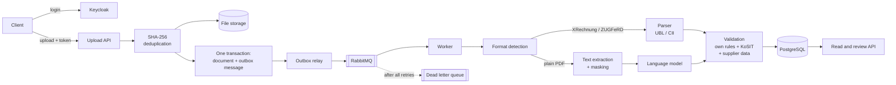

# dewtally

**Invoice and e-Rechnung processing with controlled AI.**
*dewtally — totally relaxed at the office.*

Since 2025, German companies must be able to receive electronic invoices (XRechnung, ZUGFeRD); from 2027 and 2028
they must also send them. dewtally takes incoming invoices, reads them, checks them against business rules, the
official XRechnung rules and the company's own supplier master data, and tells you which invoices are fine, which need
a human look and which are broken — and why.

> Portfolio project, built step by step. Layers 1 (structured e-invoices), 2 (AI extraction and review),
> 3 (evals: measuring AI quality) and 4 (production readiness) are done; SaaS (login, roles, tenant isolation)
> is in progress. See [ROADMAP.md](ROADMAP.md).

## What it does today

- **Login**: every API call needs a token from Keycloak (OpenID Connect); the application never handles passwords.
  Company and user name come only from the token, so nobody can act for another company or person.
- **Upload** an invoice file (`POST /api/documents`). Uploads are idempotent: the same file twice is stored once
  (SHA-256 per tenant).
- **Background processing**: the upload answers `202 Accepted` right away; a separate worker processes the document
  through RabbitMQ, and `GET /api/documents/{id}` shows its status. A transactional outbox makes sure no upload gets
  lost, even when RabbitMQ is down; temporary errors are retried, and poison messages end in a dead letter queue.
- **Detect the format**: XRechnung UBL, XRechnung CII, ZUGFeRD / Factur-X (PDF with embedded XML), plain PDF.
- **Parse** structured invoices into header data, lines, allowances and charges.
- **Read plain PDFs with AI**: a language model extracts the data; the model's own confidence and our rules decide
  whether a person has to check it.
- **Validate** in three stages:
    - dewtally's own business rules: required fields, totals (BR-CO-15), line sum with allowances and charges
      (BR-CO-13), due date, possible duplicates, extraction confidence;
    - the official **KoSIT validator** with the XRechnung configuration (schema, EN 16931 and BR-DE rules);
    - **supplier master data**: unknown or blocked supplier, invalid, unverified or changed IBAN.
- **Status** per invoice: `VALID`, `NEEDS_REVIEW` (warnings) or `INVALID` (errors), with every finding stored.
- **Review**: correct data, accept or reject an invoice; every change is recorded with who, when and why.
- **Fraud protection**: new IBANs need a second person to verify them; an invoice with a changed IBAN can only be
  accepted with an explicit, documented confirmation.
- **Data protection**: IBANs, e-mails and phone numbers are masked before text is sent to the model.
- **Measured AI quality**: an eval suite (real ZUGFeRD samples + hand-written traps) reports accuracy per field
  and fails on confident mistakes in fields that decide payment ([evals](evals/README.md)).
- **Observability**: metrics for processing time, model latency and confidence, invoice status, queue and dead
  letter queue size and outbox backlog, in Prometheus and a Grafana dashboard.
- **Errors** in the standard RFC 9457 format (`application/problem+json`).
- **Multi-tenant from day one**: every business table carries `tenant_id`.

## How it works



The application is a **modular monolith**: one code base, packages by feature (`ingestion`, `document`, `format`,
`parsing`, `extraction`, `validation`, `invoice`, `review`, `supplier`, `outbox`, `security`, `storage`, `tenant`).
It runs in two roles: the **api** and a **worker** for the untrusted, slow part (PDF parsing and the language model).

## Tech stack

| Area                 | Choice                                              |
|----------------------|-----------------------------------------------------|
| Language / framework | Java 25, Spring Boot 4                              |
| Database             | PostgreSQL 17, schema managed by Liquibase          |
| Persistence          | Spring Data JPA (Hibernate 7)                       |
| Security             | Spring Security (OAuth2 resource server), Keycloak  |
| Messaging            | RabbitMQ (Spring AMQP), transactional outbox, DLQ   |
| e-invoice validation | KoSIT validator + XRechnung configuration           |
| PDF                  | Apache PDFBox                                       |
| AI                   | Spring AI with OpenAI (structured output)           |
| Observability        | Micrometer, Prometheus, Grafana                     |
| Containers           | Docker, Docker Compose (api + worker with limits)   |
| Tests                | JUnit 5, AssertJ, Mockito, MockMvc, Testcontainers  |
| AI evals             | Own eval suite on ZUGFeRD samples and hard cases    |
| CI                   | GitHub Actions (`mvn verify` on every pull request) |

## Run locally

**Requirements:** JDK 25, Docker Desktop (running), an OpenAI API key for reading plain PDFs.

```bash
git clone https://github.com/<your-user>/dewtally.git
cd dewtally
cp .env.example .env          # then put your OPENAI_API_KEY into .env (never commit it)
docker compose up -d          # PostgreSQL, RabbitMQ, Keycloak (safe to run again)
./mvnw spring-boot:run        # Windows: .\mvnw.cmd spring-boot:run
```

This runs api and worker in one process. Liquibase creates the schema. Always start the containers with
`docker compose up -d` first: Spring Boot only starts them itself when none of them is running yet.
The XRechnung validator configuration is included in `kosit/xrechnung/`. Without an API key, structured e-invoices
work; plain PDFs go to review.

- RabbitMQ management UI: http://localhost:15672 (user and password `dewtally`).
- Keycloak: http://localhost:8180 (admin console user and password `admin`). The realm `dewtally` is imported on
  start with test users `anna` (clerk), `ben` (approver), `carla` (admin) of Demo GmbH and `otto` (clerk) of
  Other AG; the password equals the user name. Local test accounts only.

Create the two test tenants (matching the companies in Keycloak):

```sql
INSERT INTO tenant (id, name, created_at)
VALUES ('544cc1a9-416b-4715-ac24-cb559d89e262', 'Demo GmbH', now()),
       ('7d3f2c1e-5b4a-4c3d-9e8f-0a1b2c3d4e5f', 'Other AG', now());
```

## API examples

```bash
# Log in as a test user and keep the header (tokens are valid for 30 minutes)
login() {
  echo "Authorization: Bearer $(curl -s -d grant_type=password -d client_id=dewtally-cli \
       -d username=$1 -d password=$1 \
       http://localhost:8180/realms/dewtally/protocol/openid-connect/token | jq -r .access_token)"
}
ANNA=$(login anna)     # clerk
BEN=$(login ben)       # approver
CARLA=$(login carla)   # admin

# Upload an invoice: 202 Accepted, processed in the background
curl -F "file=@src/test/resources/invoices/xrechnung-ubl.xml" -H "$ANNA" http://localhost:8080/api/documents

# Processing status of a document; invoiceId is set once it is processed
curl -H "$ANNA" http://localhost:8080/api/documents/$DOCUMENT_ID

# List invoices that need a human look
curl -H "$ANNA" "http://localhost:8080/api/invoices?status=NEEDS_REVIEW"

# Invoice details with lines and findings
curl -H "$ANNA" http://localhost:8080/api/invoices/$INVOICE_ID

# Add a supplier; its IBAN starts as PENDING
curl -X POST -H "$CARLA" -H "Content-Type: application/json" \
     -d '{"name":"Muster GmbH","vatId":"DE123456789","iban":"DE89370400440532013000"}' \
     http://localhost:8080/api/suppliers

# A second person verifies the IBAN (carla, who added it, gets 409)
curl -X POST -H "$BEN" http://localhost:8080/api/suppliers/$SUPPLIER_ID/ibans/DE89370400440532013000/verify

# Accept an invoice; with a changed IBAN only with confirmation and a comment
curl -X POST -H "$BEN" -H "Content-Type: application/json" \
     -d '{"ibanConfirmed":true,"comment":"Confirmed by phone with Mr Muster on a known number"}' \
     http://localhost:8080/api/invoices/$INVOICE_ID/accept
```

Company and user name come only from the token: there is no header to choose a tenant. A user of another company
gets `404` for anything that is not theirs; the change history shows the logged-in user's name.

## Run as containers (api + worker + monitoring)

The same image runs in two roles: the **api** accepts uploads and serves the API; the **worker** parses
untrusted files and calls the language model, limited to 1 GB of memory and 1 CPU. A broken PDF can
take down at most the worker: it exits on `OutOfMemoryError`, Docker restarts it, and the unacknowledged
message goes back to the queue. The API keeps working, and uploads wait in the queue until a worker is back.

```bash
./mvnw package -DskipTests
docker compose --profile app up -d --build
docker stats --no-stream        # the worker shows its 1 GiB limit
```

- Metrics: Prometheus on http://localhost:9090, Grafana dashboard on http://localhost:3000/d/dewtally.
- The api exposes metrics on a separate management port (9091) that is not published outside Docker.
- Uploaded files live in a Docker volume shared by both roles (Azure Blob Storage in production).
- Tokens always name `http://localhost:8180` as issuer; inside Docker the signing keys are fetched from
  `keycloak:8080`.
- If a container cannot reach another one by name (`UnknownHostException: rabbitmq`), recreate them all:
  `docker compose --profile app up -d --force-recreate`.

## Tests

```bash
./mvnw verify
```

Integration tests run against a real PostgreSQL and RabbitMQ in Docker (Testcontainers), so Docker must be running.
Security tests simulate Keycloak-shaped tokens (test users anna, ben, carla), so no Keycloak is needed; a dedicated
test proves that a user of one company can neither see nor change anything of another. Most tests process uploads
synchronously; dedicated tests cover background processing, an unreachable RabbitMQ and the dead letter queue.
Tests that call the real model are skipped unless started with `-Dai=true`.

AI evals call the real model, cost a little money and are not part of the normal build:

```bash
./mvnw test -Dtest=ExtractionEval -Dai=true
```

See [evals/README.md](evals/README.md) for the test set, the regression check and results.

## Design decisions

- **Official validator instead of re-implementing XRechnung rules.** Hundreds of rules, updated regularly. Own rules
  cover business checks the standard does not (duplicates, plausible due dates, supplier data).
- **AI under control.** The model only reads; it never decides. Its answer is checked by the same rules as a
  structured invoice, uncertain answers go to a person, and model errors never reject an invoice.
- **Master data beats AI for fraud.** A fake invoice can be perfectly well-formed. Known suppliers, four-eyes IBAN
  verification and a hard stop on changed IBANs protect against payment fraud; the IBAN always comes from the
  document, never from the model.
- **Data minimisation.** Values the model does not need are masked before the text leaves the system
  ([ADR 0001](docs/adr/0001-llm-data-protection.md)).
- **Model choice by measurement, not by price list.** A cheaper model was less sure of itself and would have sent
  15 of 24 invoices to manual review instead of 1; review time costs more than API calls
  ([ADR 0002](docs/adr/0002-model-choice.md)).
- **Not all mistakes are equal.** The eval fails on confident mistakes in fields that decide payment (amounts, IBAN,
  dates); a wrong supplier name is caught by other checks and only lowers the score.
- **Transactional outbox instead of sending directly.** The document and its "process me" message are saved in one
  database transaction; a relay sends the message to RabbitMQ afterwards and retries while the broker is down.
  Delivery is at-least-once, so the processor is idempotent: a document that already has an invoice is skipped.
- **Temporary vs. permanent errors.** A broken file is handled at once (FAILED, or an invoice for manual review);
  a temporary problem (busy server, database unavailable) is retried with growing pauses. A message that fails
  every retry goes to a dead letter queue, so one poison message never blocks the others.
- **Untrusted files are parsed in a separate, limited worker.** Java cannot stop a stuck thread, so real
  isolation needs a separate process: the worker has memory and CPU limits and can crash without taking the API
  with it. Same code base and image, two Spring profiles: a modular monolith with a background worker,
  not microservices.
- **Metrics that answer business questions.** Besides JVM metrics: how many invoices need a person, how sure the
  model is, how long it takes, and whether anything is stuck in the dead letter queue or the outbox.
- **No home-made login.** Keycloak handles passwords and issues signed tokens (OpenID Connect); the API only checks
  the signature and issuer. The same code works with Microsoft Entra ID in Azure. The company is a Keycloak group
  whose `tenant_id` ends up in the token.
- **The token decides, never the request.** Controllers get a `CurrentUser` built from the signed token; there is no
  header or field to pick a company or a user. The four-eyes check and the change history compare real, logged-in
  people. Another company's data answers `404`, not `403`, so its existence is not revealed.
- **Liquibase with XML changelogs; Hibernate only validates the schema.** Database changes are explicit and reviewable.
- **Idempotent upload.** A unique constraint on `(tenant_id, sha256)` makes double uploads harmless, even when they
  race.
- **DTOs in the API, never entities.** The JSON contract is stable and does not leak internal fields.
- **Tenant in every business table now**, so isolation (and later Row-Level Security) is not a rewrite.

## Roadmap

1. ✅ Core: upload and check structured e-invoices
2. ✅ AI extraction for plain PDF invoices, review, supplier master data
3. ✅ Evals: measuring extraction quality with numbers
4. ✅ Production readiness: background worker, outbox, retries and DLQ, metrics
5. 🔄 SaaS: login and tenant from the token done; roles and Row-Level Security next
6. Azure deployment with Terraform
7. UI and showcase

Details: [ROADMAP.md](ROADMAP.md)

## Licences

The XRechnung validator configuration in `kosit/` is published by KoSIT under the Apache License 2.0.
The sample invoices in `evals/zugferd/` come from the [ZUGFeRD corpus](https://github.com/ZUGFeRD/corpus),
Apache License 2.0.