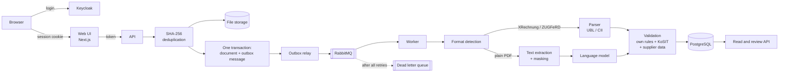

# dewtally

**Invoice and e-Rechnung processing with controlled AI.**
*dewtally — totally relaxed at the office.*

Since 2025, German companies must be able to receive electronic invoices (XRechnung, ZUGFeRD); from 2027 and 2028
they must also send them. dewtally takes incoming invoices, reads them, checks them against business rules, the
official XRechnung rules and the company's own supplier master data, and tells you which invoices are fine, which need
a human look and which are broken — and why.

> Portfolio project, built step by step. Layers 1 (structured e-invoices), 2 (AI extraction and review),
> 3 (evals: measuring AI quality), 4 (production readiness), 5 (SaaS: login, roles, tenant isolation) and
> 7 (web UI) are done; the Azure environment is ready as code and waits for its first deployment.
> See [ROADMAP.md](ROADMAP.md).


## What it does today

- **Web UI** in English and German, light and dark: invoice list with search and status filters, invoice page with
  the original document next to the extracted data, findings, VAT breakdown and change history, upload with drag
  and drop, supplier master data. Every button follows the user's role; the API checks again on every action.
- **Login**: every API call needs a token from Keycloak (OpenID Connect); the application never handles passwords.
  Company and user name come only from the token, so nobody can act for another company or person.
- **Roles**: clerks upload and correct, approvers accept or reject, admins manage suppliers. Anything not explicitly
  allowed is denied (see [Roles and permissions](#roles-and-permissions)).
- **Upload** an invoice file (`POST /api/documents`). Uploads are idempotent: the same file twice is stored once
  (SHA-256 per tenant).
- **Background processing**: the upload answers `202 Accepted` right away; a separate worker processes the document
  through RabbitMQ, and `GET /api/documents/{id}` shows its status. A transactional outbox makes sure no upload gets
  lost, even when RabbitMQ is down; temporary errors are retried, and poison messages end in a dead letter queue.
- **Detect the format**: XRechnung UBL, XRechnung CII, ZUGFeRD / Factur-X (PDF with embedded XML), plain PDF.
- **Parse** structured invoices into header data, lines, allowances and charges, and the VAT breakdown.
- **Read plain PDFs with AI**: a language model extracts the data, including the VAT breakdown; the model's own
  confidence and our rules decide whether a person has to check it.
- **Validate** in three stages:
    - dewtally's own business rules: required fields, totals (BR-CO-15), line sum with allowances and charges
      (BR-CO-13), due date, possible duplicates, extraction confidence;
    - **VAT breakdown** per category and rate: arithmetic per row and in total (BR-CO-17, BR-CO-14), German rates,
      exemption reasons; reverse charge (§ 13b UStG) and intra-EU acquisitions are flagged for accounting;
    - the official **KoSIT validator** with the XRechnung configuration (schema, EN 16931 and BR-DE rules);
    - **supplier master data**: unknown or blocked supplier, invalid, unverified or changed IBAN.
- **Status** per invoice: `VALID`, `NEEDS_REVIEW` (warnings) or `INVALID` (errors), with every finding stored.
- **Review**: correct data, accept or reject an invoice; every change is recorded with who, when and why.
- **Fraud protection**: new IBANs need a second person to verify them; an invoice with a changed IBAN can only be
  accepted with an explicit, documented confirmation.
- **Data protection**: IBANs, e-mails and phone numbers are masked before text is sent to the model.
- **Measured AI quality**: an eval suite (real ZUGFeRD samples + hand-written traps) reports accuracy per field
  and fails on confident mistakes in fields that decide payment ([evals](api/evals/README.md)).
- **Observability**: metrics for processing time, model latency and confidence, invoice status, queue and dead
  letter queue size and outbox backlog, in Prometheus and a Grafana dashboard.
- **Errors** in the standard RFC 9457 format (`application/problem+json`).
- **Tenant isolation in two layers**: every query filters by the company from the token, and PostgreSQL
  Row-Level Security filters again, so even a query that forgets the filter cannot show another company's data.

## Screenshots

| Invoice: original, findings, history          | Upload with live processing status     |
|-----------------------------------------------|----------------------------------------|
|  |  |

| Suppliers: four-eyes IBAN verification       |
|----------------------------------------------|
|  |

## How it works



The backend is a **modular monolith**: one code base, packages by feature (`ingestion`, `document`, `format`,
`parsing`, `extraction`, `validation`, `invoice`, `review`, `supplier`, `outbox`, `security`, `storage`, `tenant`).
It runs in two roles: the **api** and a **worker** for the untrusted, slow part (PDF parsing and the language model).

The web UI is a **backend for frontend**: the browser only talks to the Next.js server, which holds the user's
Keycloak tokens in an encrypted cookie and calls the API on the user's behalf. The access token never reaches
JavaScript in the browser.

The repository holds the whole product:

| Folder        | What                                                           |
|---------------|----------------------------------------------------------------|
| `api/`        | Backend: Spring Boot application, tests, AI evals, KoSIT rules |
| `web/`        | Web UI: Next.js, end-to-end tests                              |
| `infra/`      | Azure environment as Terraform code                            |
| `keycloak/`   | Login server: realm with roles, demo companies and users       |
| `monitoring/` | Prometheus and Grafana configuration                           |
| `docs/`       | Architecture decisions (ADRs), screenshots                     |

## Tech stack

| Area                 | Choice                                                                                                    |
|----------------------|-----------------------------------------------------------------------------------------------------------|
| Language / framework | Java 25, Spring Boot 4                                                                                    |
| Database             | PostgreSQL 17, schema managed by Liquibase                                                                |
| Persistence          | Spring Data JPA (Hibernate 7)                                                                             |
| Security             | Spring Security (OAuth2 resource server), Keycloak                                                        |
| Messaging            | RabbitMQ (Spring AMQP), transactional outbox, DLQ                                                         |
| e-invoice validation | KoSIT validator + XRechnung configuration                                                                 |
| PDF                  | Apache PDFBox (server), pdf.js (viewer in the browser)                                                    |
| AI                   | Spring AI with OpenAI (structured output)                                                                 |
| Web UI               | Next.js 16 (App Router, Server Actions), TypeScript, Tailwind CSS, shadcn/ui on Base UI                   |
| Web login and i18n   | Better Auth (OpenID Connect with Keycloak), next-intl (English, German)                                   |
| Observability        | Micrometer, Prometheus, Grafana                                                                           |
| Containers           | Docker, Docker Compose (api + worker with limits, web as a standalone Next.js image)                      |
| Tests                | JUnit 5, AssertJ, Mockito, MockMvc, Testcontainers; Playwright for the web UI                             |
| AI evals             | Own eval suite on ZUGFeRD samples and hard cases                                                          |
| CI                   | GitHub Actions: tests and type checks on every pull request, images to GitHub Container Registry on merge |
| Infrastructure       | Terraform: Azure Container Apps, PostgreSQL Flexible Server, Key Vault                                    |

## Run locally

**Requirements:** JDK 25, Node.js 24 with pnpm, Docker Desktop (running), an OpenAI API key for reading plain PDFs.

```bash
git clone https://github.com/newways-dev/dewtally.git
cd dewtally
cp .env.example .env          # then put your OPENAI_API_KEY into .env (never commit it)
docker compose up -d          # PostgreSQL, RabbitMQ, Keycloak; they come back by themselves after a reboot
```

Backend (api and worker in one process; Liquibase creates the schema):

```bash
cd api
./mvnw spring-boot:run        # Windows: .\mvnw.cmd spring-boot:run
```

Web UI on http://localhost:3000:

```bash
cd web
cp .env.example .env.local    # then set BETTER_AUTH_SECRET (the file explains how)
pnpm install
pnpm dev
```

Create the two test tenants once (matching the companies in Keycloak):

```sql
INSERT INTO tenant (id, name, created_at)
VALUES ('544cc1a9-416b-4715-ac24-cb559d89e262', 'Demo GmbH', now()),
       ('7d3f2c1e-5b4a-4c3d-9e8f-0a1b2c3d4e5f', 'Other AG', now());
```

Log in with a test user: `anna` (clerk), `ben` (approver), `carla` (admin) of Demo GmbH, `otto` (clerk) of Other AG.
The password equals the user name. Local test accounts only.

- The XRechnung validator configuration is included in `api/kosit/xrechnung/`. Without an API key, structured
  e-invoices work; plain PDFs go to review.
- API description: http://localhost:8080/swagger-ui.html
- RabbitMQ management UI: http://localhost:15672 (user and password `dewtally`).
- Keycloak: http://localhost:8180 (admin console user and password `admin`). The realm `dewtally` is imported on
  start.
- Do not run `docker compose down`: it removes the PostgreSQL container and with it the local data. Stop single
  services with `docker compose stop <service>`.

## API examples

```bash
# Log in as a test user and keep the header (tokens are valid for 30 minutes)
login() {
  echo "Authorization: Bearer $(curl -s -d grant_type=password -d client_id=dewtally-cli \
       -d username=$1 -d password=$1 \
       http://localhost:8180/realms/dewtally/protocol/openid-connect/token | jq -r .access_token)"
}
ANNA=$(login anna)     # clerk
BEN=$(login ben)       # approver
CARLA=$(login carla)   # admin

# Upload an invoice: 202 Accepted, processed in the background
curl -F "file=@api/src/test/resources/invoices/xrechnung-ubl.xml" -H "$ANNA" http://localhost:8080/api/documents

# Processing status of a document; invoiceId is set once it is processed
curl -H "$ANNA" http://localhost:8080/api/documents/$DOCUMENT_ID

# List invoices that need a human look
curl -H "$ANNA" "http://localhost:8080/api/invoices?status=NEEDS_REVIEW"

# Invoice details with lines, VAT breakdown and findings
curl -H "$ANNA" http://localhost:8080/api/invoices/$INVOICE_ID

# Add a supplier; its IBAN starts as PENDING
curl -X POST -H "$CARLA" -H "Content-Type: application/json" \
     -d '{"name":"Muster GmbH","vatId":"DE123456789","iban":"DE89370400440532013000"}' \
     http://localhost:8080/api/suppliers

# A second person verifies the IBAN (carla, who added it, gets 409)
curl -X POST -H "$BEN" http://localhost:8080/api/suppliers/$SUPPLIER_ID/ibans/DE89370400440532013000/verify

# Accept an invoice; with a changed IBAN only with confirmation and a comment
curl -X POST -H "$BEN" -H "Content-Type: application/json" \
     -d '{"ibanConfirmed":true,"comment":"Confirmed by phone with Mr Muster on a known number"}' \
     http://localhost:8080/api/invoices/$INVOICE_ID/accept
```

Company and user name come only from the token: there is no header to choose a tenant. A user of another company
gets `404` for anything that is not theirs; the change history shows the logged-in user's name.

## Roles and permissions

Roles are Keycloak realm roles and arrive in the token. Every endpoint is listed explicitly; any other `/api` call
is denied, even for a logged-in user. The web UI shows only the buttons a role may use; the API decides.

| Action                                 | clerk | approver | admin |
|----------------------------------------|:-----:|:--------:|:-----:|
| Read invoices, documents and suppliers |  ✅   |    ✅    |  ✅   |
| Upload an invoice                      |  ✅   |          |       |
| Correct invoice data                   |  ✅   |          |       |
| Accept or reject an invoice            |       |    ✅    |       |
| Verify a supplier IBAN                 |       |    ✅    |  ✅   |
| Add a supplier or IBAN, block, unblock |       |          |  ✅   |

No token answers `401`, a missing role `403`, both as `application/problem+json`:

```json
{
  "type": "about:blank",
  "title": "Forbidden",
  "status": 403,
  "detail": "Your role does not allow this action"
}
```

## Run as containers (api + worker + monitoring)

The same image runs in two roles: the **api** accepts uploads and serves the API; the **worker** parses
untrusted files and calls the language model, limited to 1 GB of memory and 1 CPU. A broken PDF can
take down at most the worker: it exits on `OutOfMemoryError`, Docker restarts it, and the unacknowledged
message goes back to the queue. The API keeps working, and uploads wait in the queue until a worker is back.

Stop the api in your IDE first: the container uses the same port 8080.

```bash
(cd api && ./mvnw package -DskipTests)
docker compose --profile app up -d --build
docker stats --no-stream        # the worker shows its 1 GiB limit
# afterwards, back to everyday development:
docker compose --profile app stop api worker prometheus grafana
```

CI publishes the images on every merge to `main`, with the tags `latest`, `sha-<commit>` and the version of each
release tag:

```bash
docker pull ghcr.io/newways-dev/dewtally:latest       # api and worker
docker pull ghcr.io/newways-dev/dewtally-web:latest   # web UI
```

- Metrics: Prometheus on http://localhost:9090, Grafana dashboard on http://localhost:3001/d/dewtally.
- The api exposes metrics on a separate management port (9091) that is not published outside Docker.
- Uploaded files live in a Docker volume shared by both roles (Azure file share in the cloud).
- Tokens always name `http://localhost:8180` as issuer; inside Docker the signing keys are fetched from
  `keycloak:8080`.
- If a container cannot reach another one by name (`UnknownHostException: rabbitmq`), recreate them:
  `docker compose --profile app up -d --force-recreate`.

## Deploy to Azure

The cloud environment is described with Terraform in [`infra/`](infra/README.md): web UI, api, worker, RabbitMQ and
Keycloak as Azure Container Apps, PostgreSQL Flexible Server, Key Vault for all secrets and a budget alert.
`terraform apply` creates it in Frankfurt, `terraform destroy` removes it completely.

## Tests

```bash
cd api
./mvnw verify
```

Integration tests run against a real PostgreSQL and RabbitMQ in Docker (Testcontainers), so Docker must be running.
Security tests simulate Keycloak-shaped tokens (test users anna, ben, carla), so no Keycloak is needed; a dedicated
test proves that a user of one company can neither see nor change anything of another, and another one checks the
permission matrix role by role. Tests run as the restricted database role with Row-Level Security switched on;
`RowLevelSecurityTest` sends queries without any tenant filter and shows that PostgreSQL still returns only the
current company's rows. Most tests process uploads synchronously; dedicated tests cover background processing, an
unreachable RabbitMQ and the dead letter queue. Tests that call the real model are skipped unless started with
`-Dai=true`.

The web UI has an end-to-end test with Playwright. It runs against the local stack (containers and api running) in a
real browser: anna logs in through Keycloak, uploads the official XRechnung example and corrects it; ben approves it.
Along the way it checks that each role sees only its own buttons.

```bash
cd web
pnpm exec playwright install chromium   # once
pnpm e2e                                # or "pnpm e2e --ui" to watch every step
```

AI evals call the real model, cost a little money and are not part of the normal build:

```bash
cd api
./mvnw test -Dtest=ExtractionEval -Dai=true
```

See [api/evals/README.md](api/evals/README.md) for the test set, the regression check and results.

## Design decisions

- **Official validator instead of re-implementing XRechnung rules.** Hundreds of rules, updated regularly. Own rules
  cover business checks the standard does not (duplicates, plausible due dates, supplier data), and the checks
  that must also work where the validator cannot look: ZUGFeRD without an XRechnung profile and invoices read by AI.
- **AI under control.** The model only reads; it never decides. Its answer is checked by the same rules as a
  structured invoice, uncertain answers go to a person, and model errors never reject an invoice.
- **Master data beats AI for fraud.** A fake invoice can be perfectly well-formed. Known suppliers, four-eyes IBAN
  verification and a hard stop on changed IBANs protect against payment fraud; the IBAN always comes from the
  document, never from the model.
- **Data minimisation.** Values the model does not need are masked before the text leaves the system
  ([ADR 0001](docs/adr/0001-llm-data-protection.md)).
- **Model choice by measurement, not by price list.** A cheaper model was less sure of itself and would have sent
  15 of 24 invoices to manual review instead of 1; review time costs more than API calls
  ([ADR 0002](docs/adr/0002-model-choice.md)).
- **Not all mistakes are equal.** The eval fails on confident mistakes in fields that decide payment (amounts, IBAN,
  dates); a wrong supplier name or VAT breakdown is caught by other checks and only lowers the score.
- **The VAT breakdown describes the document.** It is stored as the supplier stated it and checked, never edited.
  When a person corrects amounts or lines, it no longer matches the confirmed data: it is removed, and the change
  history keeps what it was, instead of raising errors the person cannot fix.
- **Transactional outbox instead of sending directly.** The document and its "process me" message are saved in one
  database transaction; a relay sends the message to RabbitMQ afterwards and retries while the broker is down.
  Delivery is at-least-once, so the processor is idempotent: a document that already has an invoice is skipped.
- **Temporary vs. permanent errors.** A broken file is handled at once (FAILED, or an invoice for manual review);
  a temporary problem (busy server, database unavailable) is retried with growing pauses. A message that fails
  every retry goes to a dead letter queue, so one poison message never blocks the others.
- **Untrusted files are parsed in a separate, limited worker.** Java cannot stop a stuck thread, so real
  isolation needs a separate process: the worker has memory and CPU limits and can crash without taking the API
  with it. Same code base and image, two Spring profiles: a modular monolith with a background worker,
  not microservices.
- **Metrics that answer business questions.** Besides JVM metrics: how many invoices need a person, how sure the
  model is, how long it takes, and whether anything is stuck in the dead letter queue or the outbox.
- **No home-made login.** Keycloak handles passwords and issues signed tokens (OpenID Connect); the API only checks
  the signature and issuer. The same code works with Microsoft Entra ID in Azure. The company is a Keycloak group
  whose `tenant_id` ends up in the token.
- **The token decides, never the request.** Controllers get a `CurrentUser` built from the signed token; there is no
  header or field to pick a company or a user. The four-eyes check and the change history compare real, logged-in
  people. Another company's data answers `404`, not `403`, so its existence is not revealed.
- **Separation of duties through roles.** The person who enters or corrects invoice data cannot release it for
  payment, and the person who releases payments cannot change supplier bank data. Together with the four-eyes IBAN
  check, one person alone cannot both plant a fake IBAN and pay to it.
- **Deny by default.** The permission matrix lives in one place (`SecurityConfig`); a new endpoint is forbidden until
  someone decides who may use it.
- **Backend for frontend: no token in the browser.** The web UI's server keeps the Keycloak tokens in an encrypted
  cookie and calls the API itself, through Server Actions and route handlers. A script injected into the page could
  not steal an access token, because there is none to steal. Uploads are only accepted from the UI's own pages
  (`Sec-Fetch-Site`), so another site cannot submit files in a logged-in user's name.
- **Uploaded files are untrusted, also in the browser.** Originals are served with `Content-Security-Policy: sandbox`
  and `nosniff`, with a content type the server decided from the file itself. PDFs are drawn by pdf.js inside the
  page instead of opening the file as a document; XML is shown as plain text, never rendered.
- **The UI hides, the API decides.** Buttons follow the user's roles and the invoice status, but every action is
  checked again by the API. Errors come back as problem details and are shown as clear messages: a parallel change
  answers `409` with "reload and try again" instead of silently overwriting someone else's correction.
- **Money as text on the way.** Corrected amounts travel from the form to the API as decimal strings ("1234.56"),
  never as JavaScript numbers, so no rounding can happen before they become a `BigDecimal`.
- **Infrastructure as code, created on demand.** The whole Azure environment is Terraform code: it is created when
  it is needed and destroyed afterwards, so it costs nothing in between. A budget alert warns before costs run away.
- **No secret in code, images or container settings.** Terraform generates the passwords and stores them, together
  with the OpenAI key, in Key Vault; the containers read them with a managed identity that may do nothing else.
  The web image is built without any settings; they arrive when the container starts.
- **Liquibase with XML changelogs; Hibernate only validates the schema.** Database changes are explicit and reviewable.
- **Idempotent upload.** A unique constraint on `(tenant_id, sha256)` makes double uploads harmless, even when they
  race.
- **DTOs in the API, never entities.** The JSON contract is stable and does not leak internal fields. The web UI's
  TypeScript types are generated from the API's OpenAPI description.
- **Row-Level Security as a second line of defence.** Code filters by tenant, and PostgreSQL filters again: before
  Hibernate uses a connection, it switches to the role `dewtally_app` (which cannot bypass Row-Level Security) and
  sets the tenant from the token. Without a tenant, the database shows nothing, so a mistake ends in "empty", never
  in "everything". The worker only gets a document id from the queue; a narrow database function tells it the
  document's tenant, so a forged message cannot choose one. Known limit: locally the application still connects as
  the table owner and switches roles per connection; in production it gets its own login without owner rights.

## Roadmap

1. ✅ Core: upload and check structured e-invoices
2. ✅ AI extraction for plain PDF invoices, review, supplier master data
3. ✅ Evals: measuring extraction quality with numbers
4. ✅ Production readiness: background worker, outbox, retries and DLQ, metrics
5. ✅ SaaS: login with Keycloak, roles, tenant isolation with Row-Level Security
6. 🔄 Azure deployment with Terraform: images published by CI, infrastructure code ready; first deployment next
7. ✅ Web UI: review, upload, suppliers, end-to-end test; demo video next

Domain gaps closed since: VAT breakdown per category and rate, reverse charge and intra-EU supplies.

Details: [ROADMAP.md](ROADMAP.md)

## Licences

The XRechnung validator configuration in `api/kosit/` is published by KoSIT under the Apache License 2.0.
The sample invoices in `api/evals/zugferd/` come from the [ZUGFeRD corpus](https://github.com/ZUGFeRD/corpus),
Apache License 2.0.