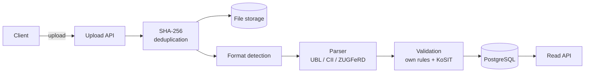

# dewtally

**Invoice and e-Rechnung processing with controlled AI.**
*dewtally — totally relaxed at the office.*

From 2027, German companies must be able to receive electronic invoices (XRechnung, ZUGFeRD), and from 2028 they must
send them. dewtally takes incoming invoices, reads them, checks them against business rules and the official XRechnung
rules, and tells you which invoices are fine, which need a human look and which are broken — and why.

> Portfolio project, built step by step. Layer 1 (structured e-invoices) is done;
> AI extraction for plain PDFs is next. See [ROADMAP.md](ROADMAP.md).

## What it does today

- **Upload** an invoice file (`POST /api/documents`). Uploads are idempotent: the same file twice is stored once
  (SHA-256 per tenant).
- **Detect the format**: XRechnung UBL, XRechnung CII, ZUGFeRD / Factur-X (PDF with embedded XML), plain PDF.
- **Parse** structured invoices into header data and lines.
- **Validate** in two stages:
    - dewtally's own business rules: required fields, totals (BR-CO-15), line sum, due date, ZUGFeRD profiles that are
      not e-invoices, possible duplicates;
    - the official **KoSIT validator** with the XRechnung configuration (schema, EN 16931 and BR-DE rules).
- **Status** per invoice: `VALID`, `NEEDS_REVIEW` (warnings) or `INVALID` (errors), with every finding stored.
- **Read API**: invoice details with lines and findings, paged list filtered by status.
- **Errors** in the standard RFC 9457 format (`application/problem+json`).
- **Multi-tenant from day one**: every table carries `tenant_id`.

## How it works



The application is a **modular monolith**: one deployable, packages by feature (`ingestion`, `format`, `parsing`,
`validation`, `invoice`, `storage`, `tenant`). The boundaries are drawn so that parts can be moved into separate
services later (AI extraction will run in its own worker).

## Tech stack

| Area                 | Choice                                              |
|----------------------|-----------------------------------------------------|
| Language / framework | Java 25, Spring Boot 4                              |
| Database             | PostgreSQL 17, schema managed by Liquibase          |
| Persistence          | Spring Data JPA (Hibernate 7)                       |
| e-invoice validation | KoSIT validator + XRechnung configuration           |
| PDF                  | Apache PDFBox                                       |
| Tests                | JUnit 5, AssertJ, Mockito, MockMvc, Testcontainers  |
| CI                   | GitHub Actions (`mvn verify` on every pull request) |

## Run locally

**Requirements:** JDK 25, Docker Desktop (running).

```bash
git clone https://github.com/<your-user>/dewtally.git
cd dewtally
./mvnw spring-boot:run        # Windows: .\mvnw.cmd spring-boot:run
```

Docker Compose starts PostgreSQL automatically, Liquibase creates the schema. The XRechnung validator configuration is
included in `kosit/xrechnung/`.

Create a tenant (there is no login yet; it comes in layer 5):

```sql
INSERT INTO tenant (id, name, created_at)
VALUES ('544cc1a9-416b-4715-ac24-cb559d89e262', 'Demo GmbH', now());
```

## API examples

```bash
# Upload an invoice
curl -F "file=@src/test/resources/invoices/xrechnung-ubl.xml" \
     -H "X-Tenant-Id: 544cc1a9-416b-4715-ac24-cb559d89e262" \
     http://localhost:8080/api/documents

# List invoices that need a human look
curl -H "X-Tenant-Id: 544cc1a9-416b-4715-ac24-cb559d89e262" \
     "http://localhost:8080/api/invoices?status=NEEDS_REVIEW"

# Invoice details with lines and findings
curl -H "X-Tenant-Id: 544cc1a9-416b-4715-ac24-cb559d89e262" \
     http://localhost:8080/api/invoices/<invoice-id>
```

## Tests

```bash
./mvnw verify
```

Integration tests run against a real PostgreSQL in Docker (Testcontainers), so Docker must be running.

## Design decisions

- **Official validator instead of re-implementing XRechnung rules.** Hundreds of rules, updated regularly. Own rules
  cover business checks the standard does not (duplicates, plausible due dates).
- **Liquibase with XML changelogs; Hibernate only validates the schema.** Database changes are explicit and reviewable.
- **Idempotent upload.** A unique constraint on `(tenant_id, sha256)` makes double uploads harmless, even when they
  race.
- **DTOs in the API, never entities.** The JSON contract is stable and does not leak internal fields.
- **Tenant in every table now**, so isolation (and later Row-Level Security) is not a rewrite.

## Roadmap

1. ✅ Core: upload and check structured e-invoices
2. AI extraction for plain PDF invoices, review queue
3. Evals: measuring extraction quality with numbers
4. Production readiness: worker, RabbitMQ, outbox, metrics, Grafana
5. SaaS: login, roles, tenant isolation
6. Azure deployment with Terraform
7. UI and showcase

Details: [ROADMAP.md](ROADMAP.md)

## Licences

The XRechnung validator configuration in `kosit/` is published by KoSIT under the Apache License 2.0.